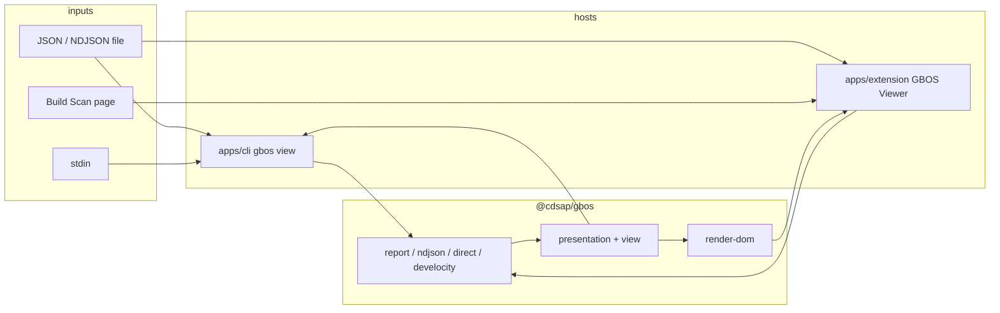

# feat: GBOS CLI and Chrome viewer hosts

## Goal Capsule

Objective: Someone with a GBOS JSON or NDJSON file (or a live Build Scan page) can inspect the same observations from a command line or a Chrome window, without treating Develocity as the product.

Means: Two hosts in this repository that import published `@cdsap/gbos` adapters, view planning, and DOM rendering; Chrome and Node APIs stay in the hosts (KTD1).

Stop when: `gbos view` prints a useful table for report/NDJSON/observation/projection files, the Chrome viewer opens those same files, and an optional page source can reconstruct GBOS from a Build Scan without putting Develocity in the extension name.

## Product Contract

### Summary

Add a CLI (`gbos`) and a Chrome extension (`GBOS Viewer`) in `build-observability-client`. Both parse GBOS transports through `@cdsap/gbos`. Files and stdin are first-class. A live Build Scan page is an optional extra source for the extension, not the product identity.

### Problem Frame

GBOS producers already write JSON, NDJSON, and Build Scan custom values. The library can parse and plan views, but there is no user-facing host. People who never open a Build Scan still need to read `gbos.json` / `gbos.ndjson`. People who do open a scan should get the same viewer without a Develocity-branded extension.

### Requirements

- R1. A CLI named `gbos` reads a file path or stdin and shows GBOS observations as terminal text (summary + table). Diagnostics go to stderr. Exit non-zero only when the input cannot yield any dataset (hard parse failure), not when the dataset is partial.
- R2. The CLI auto-detects report JSON, NDJSON, a standalone observation, an observation batch, and a Develocity custom-value projection. `--format` overrides detection.
- R3. A Chrome Manifest V3 extension named **GBOS Viewer** (not Develocity) lets the user open local `.json` / `.ndjson` files and renders the same view model via `@cdsap/gbos/render-dom`.
- R4. On a live Build Scan page, the user can opt in to read GBOS custom values from that page. Selectors, `chrome.*`, and URL matching live only in the extension host. The library keeps using `createExtensionAdapter` / `parseDevelocityProjection`.
- R5. Neither host reimplements GBOS parsing, validation, or view planning. They call published subpaths of `@cdsap/gbos`.
- R6. File-derived views must match library parse results for the same bytes (same observation count, same diagnostics codes). Page-derived views must match `parseDevelocityProjection` on the collected custom values.
- R7. Untrusted observation text is never assigned as HTML. The extension uses `renderViewSpec` (`textContent` / attributes only).
- R8. Product copy, store listing, toolbar tooltip, and CLI `--help` say GBOS / build observability. They do not name the extension as a Develocity product. Adapter and flag names may still say “projection” or “scan page” where that is the transport.

### Actors

- A1. Build engineer with `gbos.json` / `gbos.ndjson` on disk and no Build Scan.
- A2. Engineer looking at a Build Scan that already has GBOS custom values.
- A3. Implementer of `@cdsap/gbos` who must not take Chrome or `node:*` into core `src/`.

### Flows

- F1. CLI file: `gbos view path/to/gbos.json` → detect report → print summary and observation table → exit 0.
- F2. CLI stdin: `cat gbos.ndjson | gbos view -` → NDJSON parse → same kind of table.
- F3. CLI override: `gbos view --format projection scan.json` when auto-detect would be wrong.
- F4. Extension file: user opens GBOS Viewer → chooses a local JSON/NDJSON file → panel shows summary, table, chart, diagnostics.
- F5. Extension page: user on a Build Scan → chooses “Read this page” → content script collects custom values → service worker → same panel. Denied permission or empty GBOS set shows a diagnostic, not a crash.

### Acceptance Examples

- AE1. `examples`-shaped report JSON from the schema repo (or `test/fixtures/conformance.json` report-like payloads) via CLI prints at least observation count and one table row per observation.
- AE2. NDJSON with one valid observation and one malformed line: valid row printed, diagnostic on stderr, exit 0.
- AE3. Empty file or `{ }` : diagnostic, no fake observations, non-zero exit.
- AE4. Extension loads the same report file as AE1 and shows the same observation count.
- AE5. Extension given the fixture custom-value list from `test/render-extension.test.mjs` (via page adapter or injected fixture) shows one observation and does not interpret `""` as markup.
- AE6. `--help` / extension name string tests: no “Develocity” in the CLI product name or extension `name` / `action.default_title`.

### Success Criteria

An engineer can inspect producer output from disk in under one command, and from Chrome without installing a second repo. Core `npm run check` still forbids `chrome` and `node:*` in `src/` except `src/render/`.

### Scope Boundaries

In scope: workspace layout, `gbos` CLI, GBOS Viewer MV3 extension, transport detection in hosts, file + optional scan-page sources, tests for both hosts.

Deferred for later: Vega-Lite exporter, terminal charts beyond ASCII/text tables, OTLP export, Chrome Web Store listing polish, Firefox, authenticated download of scans from an API.

Outside this product: changing producer plugins, changing GBOS schema, publishing the hosts as part of the `@cdsap/gbos` npm tarball, embedding Develocity credentials.

### Key Decisions

- KD1. Same repository as the library, not a new GitHub repo. (session-settled: user-directed — chosen over a separate repo: hosts and library stay in lockstep.)
- KD2. Do not brand the Chrome host as a Develocity extension. (session-settled: user-directed — chosen over a Develocity-named extension: GBOS is source-neutral.)
- KD3. JSON/NDJSON files are first-class for both hosts. (session-settled: user-directed — chosen over scan-page-only: not every GBOS document lives in a Build Scan.)
- KD4. The extension may also read a live Build Scan page as an optional source. (session-settled: user-directed — chosen over files-only: page source is extra, not the name.)

Governs R1–R8.

## Planning Contract

### Key Technical Decisions

- KTD1. Hosts live under `apps/cli` and `apps/extension`. They depend on `@cdsap/gbos` and must not move Chrome, `node:fs`, or `fetch` into library `src/`. Matches ADR 0001 (core is ECMAScript-only; acquisition stays in the host).
- KTD2. Keep `@cdsap/gbos` at the repository root `package.json`. Add npm `workspaces: ["apps/*"]` rather than relocating the published package in this plan.
- KTD3. Transport detection belongs in a small shared host helper (`apps/shared/detect-transport.ts` or equivalent), not a new public library export, unless both hosts would otherwise duplicate non-trivial sniffing. Detection order: explicit `--format` / UI choice, then NDJSON (newline JSON values), then report envelope (`schemaVersion` + `resource`), then projection (`customValues` or a list of `{name,value}`), then standalone observation / batch.
- KTD4. CLI surface is `gbos view [file]` with `-` for stdin and `--format report|ndjson|observation|batch|projection`. No subcommands beyond `view` and `--help` in this plan.
- KTD5. Extension UI is a side panel (fallback: popup + full page) that renders `createObservationViewSpec` for file sources and `createDevelocityViewSpec` for projection/page sources, then `renderViewSpec`. Optional host permissions for scan origins; do not request `<all_urls>` up front.
- KTD6. Bundle the extension with a small ESM bundler (esbuild is enough) so MV3 content/service-worker scripts import the library without Node resolution. CLI runs on Node 22+ via `bin` pointing at compiled JS.

### High-Level Technical Design



Hosts sniff or accept an explicit format, call the matching adapter, then either print `ViewSpec` sections as text (CLI) or mount them in the panel (extension). The page path uses `PageSourceAdapter` + `createExtensionAdapter` already in `src/adapters/extension.ts`.

### Output Structure

```text
package.json                 # @cdsap/gbos + workspaces
apps/
  shared/                    # detect-transport + ViewSpec-to-text
  cli/
    package.json             # bin: gbos
    src/main.ts
    test/*.test.mjs
  extension/
    package.json
    manifest.json            # name: GBOS Viewer
    src/background.ts
    src/content.ts           # optional, scan page only
    src/panel.ts
    test/*.test.mjs
```

### Assumptions

- Node 22+ matches the library `engines` field.
- “Build Scan page” means a page that already exposes GBOS custom values in the DOM or scan JSON the content script can read; exact selectors are implementation-time and stay in `apps/extension`.
- First CLI output is text tables, not a pager TUI.

### Sequencing

U1 layout and shared detection → U2 CLI → U3 extension files → U4 optional page source. U2 can ship without the extension. U4 must not block file viewing.

## Implementation Units

### U1. Workspace hosts and transport detection

Goal: Apps can import `@cdsap/gbos` and classify a buffer as report, NDJSON, observation, batch, or projection.

Requirements: R2, R5; KD1–KD3; KTD1–KTD3.

Files: `package.json`, `apps/shared/detect-transport.ts`, `apps/shared/detect-transport.test.mjs`, `apps/cli/package.json`, `apps/extension/package.json`.

Approach: Add workspaces. Detection is pure (string → kind + parse options). Tests use snippets from `test/fixtures/` and `test/fixtures/develocity-transports.json`. Do not add `node:*` to library `src/`.

Test scenarios:

- Happy: report JSON with `schemaVersion` + `resource` + `observations` classifies as report.
- Happy: two JSON observation lines classify as ndjson.
- Edge: single-line JSON observation classifies as observation, not ndjson.
- Error: empty string / whitespace classifies as unknown, not report.
- Happy: `{ customValues: [{name,value}] }` classifies as projection.

Verification: `node --test apps/shared/detect-transport.test.mjs` (or the workspace test script chosen in U1). Library `npm run check` still passes.

Dependencies: none.

### U2. `gbos view` CLI

Goal: From a terminal, print GBOS from a file or stdin.

Requirements: R1, R2, R5, R6, R8; F1–F3; AE1–AE3, AE6; KTD4.

Files: `apps/cli/src/main.ts`, `apps/cli/src/print-view.ts`, `apps/cli/test/view.test.mjs`, `apps/shared/print-view.ts` if shared with nothing else yet.

Approach: Read file or stdin as UTF-8. Detect or honor `--format`. Call `parseReport` / `parseNdjson` / `parseObservation(s)` / `parseDevelocityProjection`. Build `createObservationViewSpec` or `createDevelocityViewSpec`. Print title, diagnostics, summary items, then tables. Charts can be skipped in v1 CLI or printed as label/value lines. `--help` text uses “GBOS”, not a Develocity product name.

Execution note: characterization — pin stdout/stderr against fixture files so later renderer tweaks are visible.

Test scenarios:

- Happy: conformance report fixture → exit 0, stdout contains observation count matching `parseReport`.
- Happy: NDJSON fixture → one row per valid line.
- Edge: mixed valid + invalid NDJSON line → exit 0, stderr contains `malformed_json` or `malformed_observation`.
- Error: missing file → non-zero, no empty success table.
- Error: `--format report` on NDJSON → diagnostic, non-zero.
- Integration: `gbos view -` reads stdin.
- AE6: help text has no product name “Develocity”.

Verification: `apps/cli` tests plus a packed `gbos view` smoke on `test/fixtures/conformance.json`.

Dependencies: U1.

### U3. GBOS Viewer file UI

Goal: Chrome extension opens local JSON/NDJSON and renders via `renderViewSpec`.

Requirements: R3, R5–R8; F4; AE4, AE5 (file path), AE6; KTD5, KTD6.

Files: `apps/extension/manifest.json`, `apps/extension/src/panel.ts`, `apps/extension/src/load-file.ts`, `apps/extension/test/panel.test.mjs`, bundle script in `apps/extension/package.json`.

Approach: MV3 extension, `name` = `GBOS Viewer`. File picker / drag-drop in the panel. Reuse U1 detection. Render into a host element with `renderViewSpec`. Bundle `@cdsap/gbos` with esbuild. Tests can run `load-file` + `renderViewSpec` against FakeDocument from `test/render-extension.test.mjs` without launching Chrome. Optional: Playwright/Puppeteer later; not required to land U3.

Test scenarios:

- Happy: same report bytes as U2 → panel observation count matches CLI.
- Happy: NDJSON file renders table rows.
- Edge: file with diagnostics shows them in the diagnostic list, previous empty host is filled.
- Error: unreadable / unknown JSON shows an error diagnostic and no fabricated observations.
- AE5: attribute containing `` is `textContent`, not a child element named `img`.
- AE6: `manifest.json` `name` and `action.default_title` are `GBOS Viewer`.

Verification: extension unit tests + `npm run check` at repo root.

Dependencies: U1. Can parallelize with U2 after U1.

### U4. Optional live Build Scan page source

Goal: From GBOS Viewer, read GBOS custom values on a Build Scan page the user already has open.

Requirements: R4, R5, R7; F5; AE5; KTD5.

Files: `apps/extension/src/content.ts`, `apps/extension/src/background.ts`, `apps/extension/src/page-source.ts`, `apps/extension/test/page-source.test.mjs`.

Approach: Content script implements `PageSourceAdapter.readCustomValues()`. Background implements `ExtensionPort`. Panel calls `createExtensionAdapter(...).requestFromServiceWorker()`. Use optional host permissions; if missing, prompt once. Parsing stays `parseDevelocityProjection`. Document in extension README that this source is optional and unnamed in the store title.

Test scenarios:

- Happy: fixture custom values through fake port → same observation count as `parseDevelocityProjection`.
- Error: user denies permission → diagnostic in panel, file UI still works.
- Error: page has no GBOS keys → empty observations + informational diagnostic.
- Integration: file path from U3 still works with content script present.

Verification: unit tests around the adapter seam; no requirement to hit a real scan host in CI.

Dependencies: U3.

## Verification Contract

Repo root (library, must stay green):

```bash
npm ci
npm run check
npm test
```

Hosts (added by this plan):

```bash
npm test --workspaces
# or per app:
node --test apps/shared/*.test.mjs apps/cli/test/*.test.mjs apps/extension/test/*.test.mjs
```

Boundary still enforced by `test/boundary.test.mjs`: no `chrome` / `node:` in core `src/`.

Manual: load unpacked `apps/extension` dist in Chrome, open a producer `gbos.json`, then optionally a Build Scan tab.

## Definition of Done

- `gbos view` handles report, NDJSON, observation, and projection inputs per R1–R2.
- GBOS Viewer opens those files and optionally a scan page per R3–R4.
- Library package boundary unchanged (ADR 0001 / `npm run check`).
- AE1–AE6 covered by automated tests except the unpacked Chrome load (manual).
- No abandoned workspace scaffolding left in the diff.
- README at repo root mentions CLI and GBOS Viewer as hosts, not as Develocity products.

### Per unit

- U1: detection tests pass; workspaces install.
- U2: CLI tests pass; help text branding check passes.
- U3: panel tests pass; manifest name is GBOS Viewer.
- U4: page-adapter tests pass; file flow still green.
